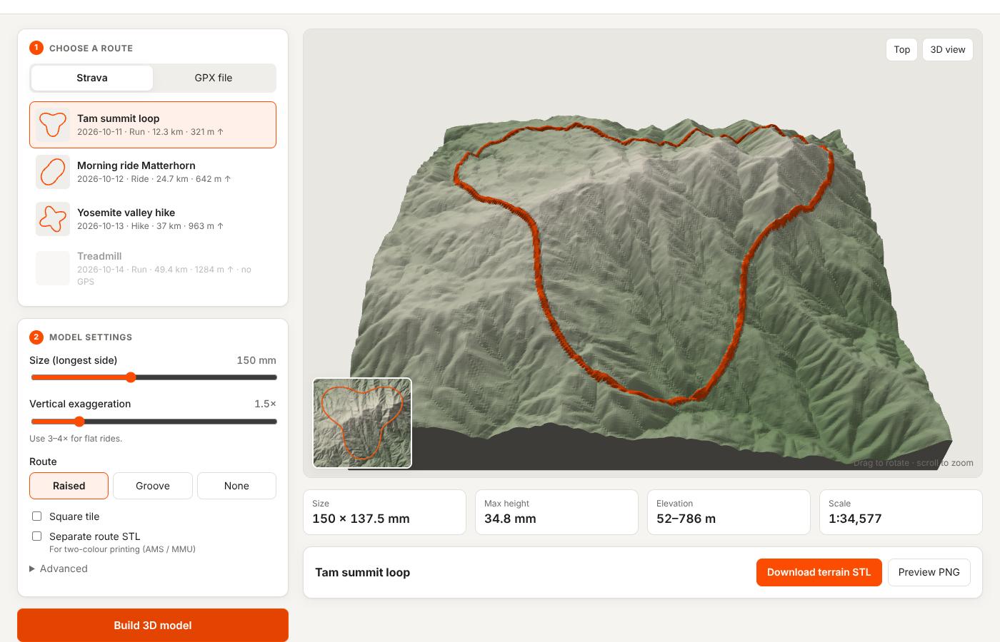

# Strava 3D

Turn your Strava activities into **3D-printable terrain models**. The tool connects to
your Strava account through the official API, downloads the GPS track of an activity,
gets elevation data for the surrounding area, and writes a watertight STL: a terrain
tile with your route raised on it (or cut into it). It also writes a PNG preview.



## How it works

1. **Strava API**: OAuth login, then the activity's full-resolution `latlng` stream.
2. **Elevation**: free global [AWS Terrain Tiles](https://registry.opendata.aws/terrain-tiles/)
   (Terrarium PNG encoding, no API key needed; up to about 5 m/pixel). Tiles are cached in `~/.cache/strava3d`.
3. **Mesh**: the terrain becomes a closed heightmap solid with a flat base. The route
   is drawn into it as a raised ridge or a groove, or exported as a separate body for
   multi-colour printing.

## Setup

```bash
git clone https://github.com/elsidpanolino/strava_3d.git
cd strava_3d
python -m venv .venv && source .venv/bin/activate
pip install -e .
```

### Create a Strava API application

1. Go to <https://www.strava.com/settings/api> and create an app.
2. Set **Authorization Callback Domain** to `localhost`.
3. Copy `.env.example` to `.env` and fill in your **Client ID** and **Client Secret**.

## Web interface (easiest)

```bash
strava3d ui
```

This opens <http://localhost:8765> in your browser. There you can:

1. **Set up**: paste your Strava Client ID and Client Secret (first run only; they're saved in
   `~/.config/strava3d/credentials.json`). If you prefer, put them in `.env` instead.
2. **Connect with Strava**: log in once. Disconnect from the top-right corner.
3. **Choose a route**: pick an activity from your list (with route thumbnails), or drop in a GPX file.
4. **Tune it**: size, vertical exaggeration, route style, square tile, separate route body,
   plus advanced options.
5. **Build**: rotate and zoom the result in the 3D viewer, then download the STL files.

The viewer is plain WebGL with no external scripts, so the UI also works offline
once elevation tiles are cached.

## Command line

### Connect your account

```bash
strava3d auth
```

A browser window opens. When you approve access, Strava redirects to
`http://localhost:8765/callback` and the token is saved to
`~/.config/strava3d/token.json`. Tokens are refreshed automatically after that.

## Usage

```bash
strava3d activities                 # list recent activities with their IDs
strava3d build 1234567890           # build a model from one activity
strava3d latest                     # build from your most recent GPS activity
strava3d gpx examples/tamalpais-loop.gpx   # build from a GPX file (no Strava needed)
```

Output goes to `./output/`:

- `<name>-terrain.stl`: the terrain tile, ready to slice
- `<name>-route.stl`: the route as its own body (only with `--separate-route`)
- `<name>-preview.png`: a shaded top-down preview

### Model options

| Option | Default | Description |
|---|---|---|
| `--size` | 150 | Longest side of the model in mm |
| `--resolution` | 0.5 | Mesh cell size in mm (smaller gives more detail and bigger files) |
| `--exaggeration` | 1.5 | Vertical exaggeration. Use 2–4 for flat areas. |
| `--base` | 3 | Base thickness under the lowest point, in mm |
| `--padding` | 0.1 | Terrain margin around the route (fraction of route size) |
| `--square` | off | Make the tile square |
| `--route` | raised | `raised`, `groove`, or `none` |
| `--route-width` | 1.6 | Route line width in mm (keep it at least 2× your nozzle width) |
| `--route-height` | 1.0 | How far the route is raised or grooved, in mm |
| `--separate-route` | off | Export the route as a separate STL for multi-colour printing |
| `-o / --out` | output | Output directory |

### Examples

```bash
# Flat road ride: exaggerate the relief more
strava3d build 1234567890 --exaggeration 4 --size 180

# Two-colour print (for example, AMS or MMU): load both STLs as parts of one object
strava3d build 1234567890 --separate-route --square

# Carve the route into the terrain instead of raising it
strava3d build 1234567890 --route groove --route-height 1.2
```

## Printing tips

- Print flat on the base. No supports are needed.
- 0.12–0.2 mm layers bring out the terrain detail. 10–15 % infill is plenty.
- For two colours without a multi-material printer, use the default raised route and
  add a filament change at the layer where the route sits above the terrain.
  For a hilly area, painting the route works better.
- For multi-colour printing, import `*-terrain.stl` and `*-route.stl` together and accept
  "load as a single object with multiple parts" in your slicer (Bambu Studio, PrusaSlicer,
  or Orca). Then give the route part a different filament.

## Development

```bash
pip install -e ".[test]"
pytest
```

## Notes

- Strava's API terms allow use with your own data. Rate limits are 100 requests per 15 min
  and 1,000 per day, and one model uses about 3 requests.
- Elevation data © Mapzen / AWS Terrain Tiles, which include SRTM, GMTED, NED, ETOPO1 and other sources.
  See [attribution](https://github.com/tilezen/joerd/blob/master/docs/attribution.md).
- `examples/tamalpais-loop.gpx` is a synthetic loop on real terrain, used for testing.
